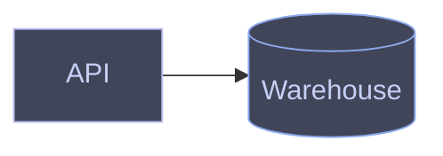

# Diagram theme

One theme for every diagram: Catppuccin Frappe for dark, Rosé Pine Dawn for light, with one semantic-class vocabulary expressed per language. Style only through these classes, with no ad-hoc hex in diagram source.

## Semantic classes

Same class names in every diagram, both languages. Color reinforces meaning; the diagram must still read without it.

| Class | Meaning |
| --- | --- |
| `accent` | Primary subject or emphasized path |
| `data` | Stores — warehouses, databases, caches |
| `process` | Default compute/service nodes (usually the unstyled baseline) |
| `decision` | Branch points |
| `good` | Success paths, terminal-good states |
| `warn` | Failures, alerts, risky paths |
| `external` | Third-party or out-of-scope systems (dashed border) |

The Mermaid and D2 blocks below give each class its Frappe colors in source, which is all a GitHub fence or a plain `d2` preview shows. `diagram.ts` renders override those colors and paint the full theme, light and dark, from `scripts/theme.ts`; that file mirrors these token tables, so change both together.

## Palettes

Frappe is the primary scheme. `diagram.ts` renders use Dawn for `--mode light` and for light-mode viewers of `auto` SVGs. Mermaid fences and plain `d2` previews carry only the Frappe colors written in the source.

### Frappe

| Token | Value |
| --- | --- |
| base / mantle | `#303446` / `#292c3c` |
| surface0 / surface1 | `#414559` / `#51576d` |
| text / subtext | `#c6d0f5` / `#b5bfe2` |
| overlay (lines) | `#737994` |
| lavender / mauve | `#babbf1` / `#ca9ee6` |
| blue | `#8caaee` |
| green | `#a6d189` |
| peach / red | `#ef9f76` / `#e78284` |
| yellow | `#e5c890` |
| teal | `#81c8be` |

### Rosé Pine Dawn

| Token | Value | Class |
| --- | --- | --- |
| base / surface | `#faf4ed` / `#fffaf3` | background / `external` fill |
| overlay | `#f2e9e1` | node fill |
| text / subtle / muted | `#575279` / `#797593` / `#9893a5` | text / muted text / lines |
| highlight high | `#cecacd` | borders |
| iris | `#907aa9` | `accent` |
| foam | `#56949f` | `data` |
| pine | `#286983` | `good` |
| gold | `#ea9d34` | `decision` |
| love | `#b4637a` | `warn` |

## Mermaid



## D2

```d2
classes: {
  accent: {style.fill: "#414559"; style.stroke: "#babbf1"; style.font-color: "#c6d0f5"}
  data: {shape: cylinder; style.fill: "#414559"; style.stroke: "#8caaee"; style.font-color: "#c6d0f5"}
  decision: {shape: diamond; style.fill: "#414559"; style.stroke: "#e5c890"; style.font-color: "#c6d0f5"}
  good: {style.fill: "#414559"; style.stroke: "#a6d189"; style.font-color: "#c6d0f5"}
  warn: {style.fill: "#414559"; style.stroke: "#e78284"; style.font-color: "#c6d0f5"}
  external: {style.fill: "#292c3c"; style.stroke: "#737994"; style.font-color: "#b5bfe2"; style.stroke-dash: 4}
}
```

## Contrast rule

Whatever the theme, verify the render in both light and dark destination modes when the destination adapts (GitHub, Obsidian). Explicit fills stay fixed across modes, so a diagram authored for one background must not become illegible on the other — prefer the destination's adaptive default over a hard-coded theme when both modes matter and you can't check both.
